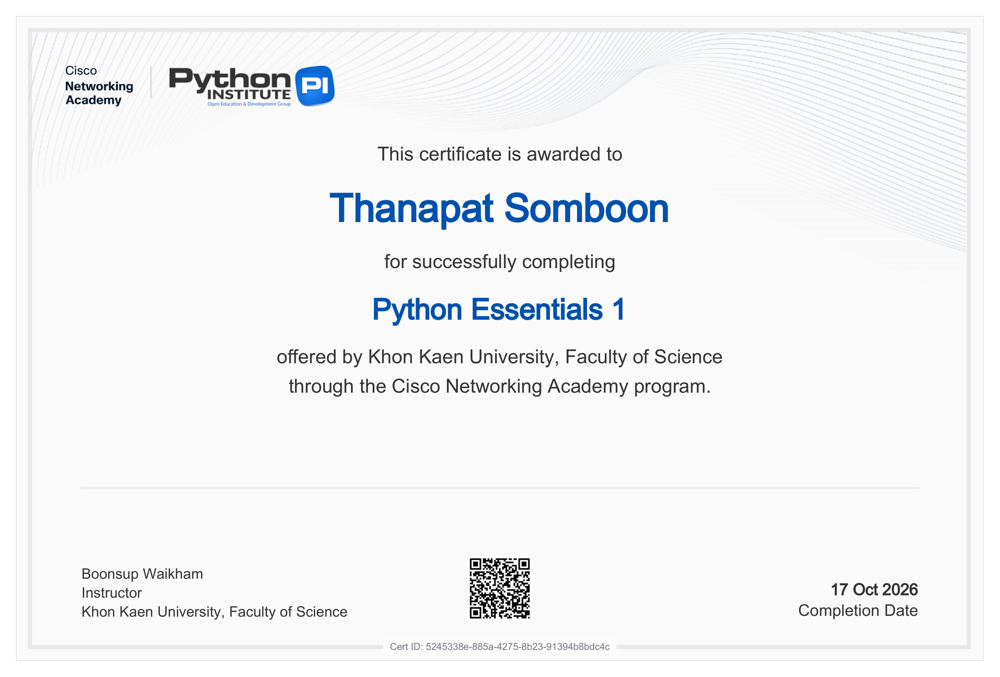

# Certificate

Certificate จาก [netacad.com](https://www.netacad.com/) (Cisco Networking Academy)

## Python Essentials 1

|  |  |
|---|---|
| **ผู้ได้รับ** | Thanapat Somboon (นายธนภัทร สมบูรณ์) |
| **หลักสูตร** | Python Essentials 1 |
| **ผู้จัดอบรม** | Khon Kaen University, Faculty of Science — ผ่านโปรแกรม Cisco Networking Academy |
| **ผู้สอน** | Boonsup Waikham |
| **วันที่สำเร็จ** | 17 Oct 2026 |
| **Cert ID** | `5245338e-885a-4275-8b23-91394b8bdc4c` |

## ไฟล์ในโฟลเดอร์นี้

| ไฟล์ | รายละเอียด |
|---|---|
| `Python_Essentials_1_certificate.png` | ไฟล์ภาพ certificate (แปลงจาก PDF ต้นฉบับ) |
| `Python_Essentials_1_certificate.pdf` | ไฟล์ PDF ต้นฉบับที่ดาวน์โหลดจาก netacad.com |
